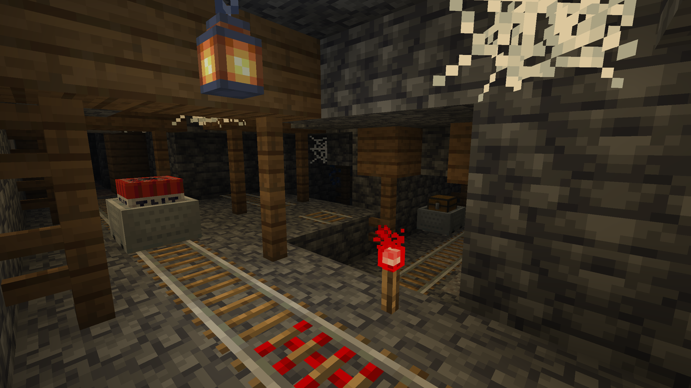
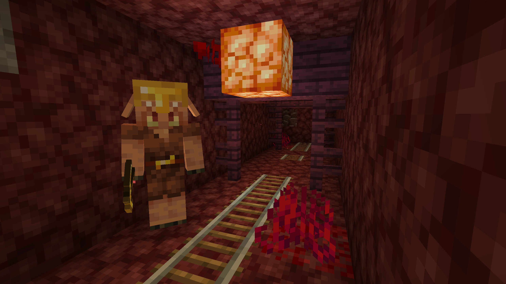
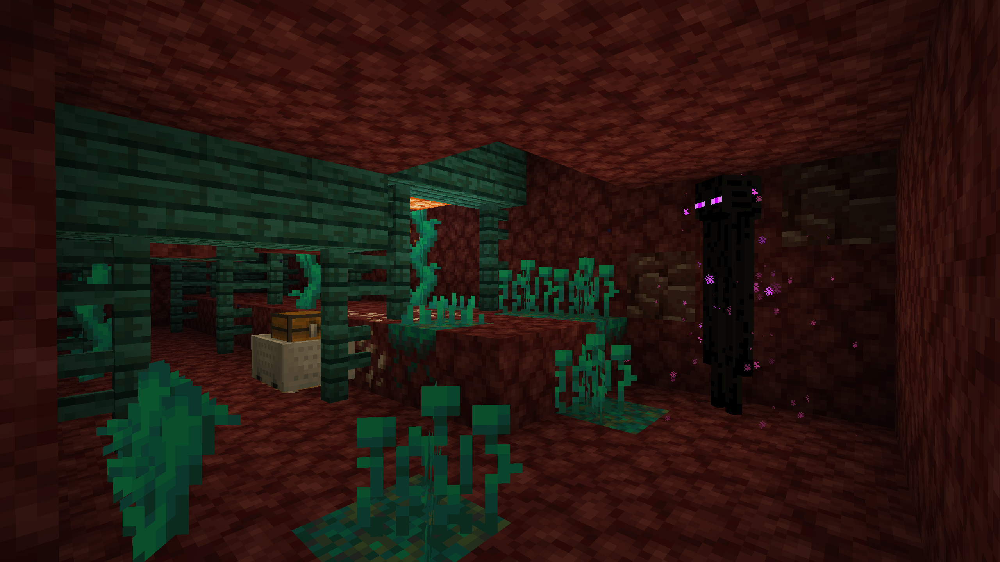
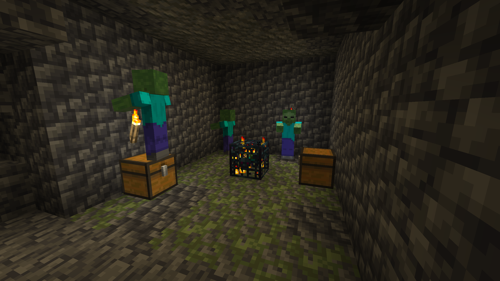
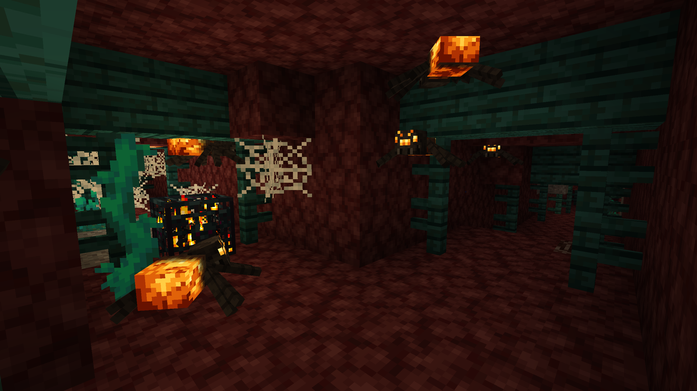
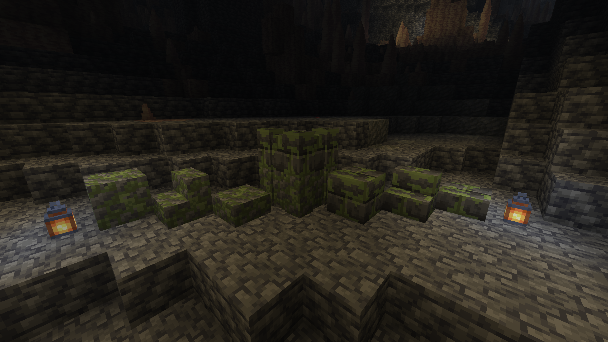

# Deeper Delvings

Adds new underground structure variants, a new mob and a new block set to make exploring below the surface more interesting. Everything can be configured or turned off.

## Deepslate mineshafts

Mineshafts that start at deepslate levels are replaced with deepslate mineshafts.
- Built from spruce wood and lit by lanterns.
- More frequent and more continuous rails, with occasional activator rails powered by redstone torches.
- TNT minecarts sitting on the rails.
- Twice as many chest minecarts, with vanilla mineshaft loot plus a small balanced extra pool.

## Nether mineshafts

Crimson and warped mineshafts generate underneath the lava sea in crimson and warped forests.
- Built from the matching Nether wood set and lit by shroomlights.
- Fiery Spider spawners instead of cave spider spawners, and Nether foliage instead of cobwebs.
- Ancient debris hidden at the dead ends of corridors.
- Ladder shafts leading up to large lava lakes above some rooms.
- Unique chest minecart loot.
- Crimson mineshafts have piglin miners and only spawn piglins naturally, while warped mineshafts have endermen and only spawn endermen naturally.

## Deepslate dungeons

Dungeons at deepslate levels are built from cobbled deepslate and mossy cobbled deepslate, and their chests hold vanilla dungeon loot plus a small balanced extra pool.

## Fiery Spider

A cave spider variant with a glowing fiery abdomen. It sets its target on fire instead of poisoning it and sets the ground on fire when it dies. It spawns from spawners in Nether mineshafts and replaces spiders in a configurable list of biomes, which contains the Inferno biome from CliffTree by default.

## Mossy Deepslate

Mossy deepslate counterparts of the vanilla mossy blocks: mossy cobbled deepslate and mossy deepslate bricks with their stairs, slabs and walls, and infested mossy deepslate bricks. Crafted like their vanilla counterparts, using cobbled deepslate or deepslate bricks with vines or moss blocks, and supported by the stonecutter.

## Other features

These are off or set to vanilla values by default.
- **Bonus chests**: Place extra loot chests at random enclosed spots inside structures, with configurable chances. For now woodland mansions and ocean monuments are supported.
- **Ore size multipliers**: Scale Overworld ore vein sizes by depth, with configurable multipliers and heights, globally or per ore.
- **Structure spawn multipliers**: Adjust how often dungeons and mineshafts generate, globally or per dungeon and mineshaft variant.
- **Cave ambient sound frequency**: Adjust how often cave ambient sounds play.
